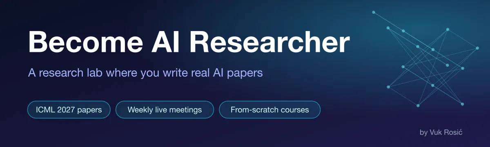
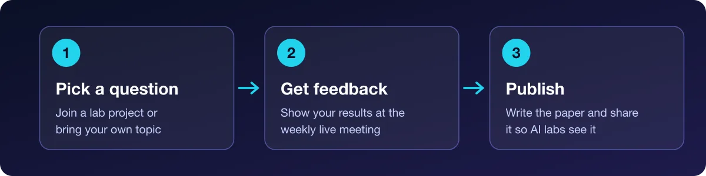
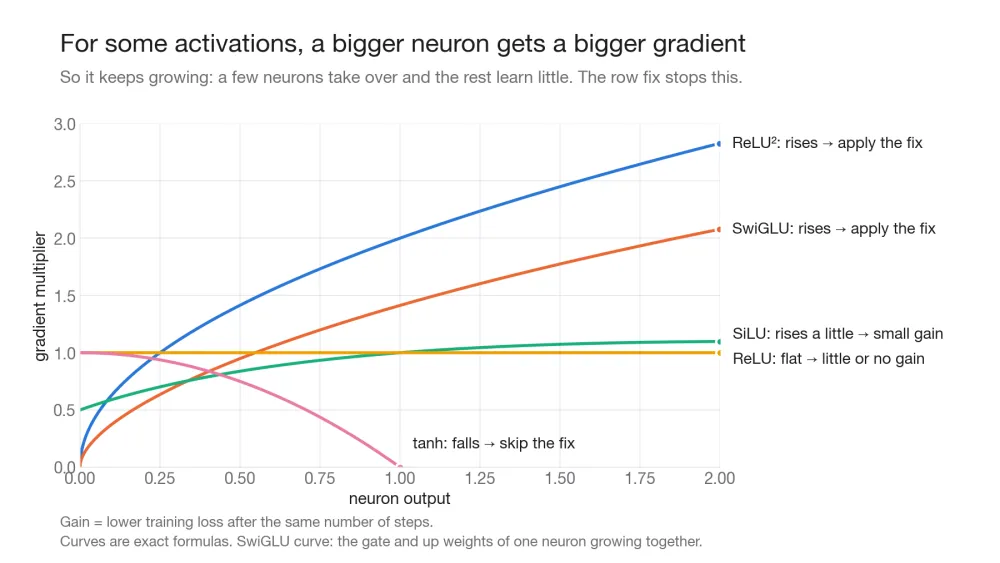

  

  
  &nbsp;
  

<b>Get an AI research job or start a PhD in 6–12 months.</b>

We are writing papers for **ICML 2027**, a top AI conference with a January 2027 deadline. Publish your own paper, or join mine or other members' papers as a co-author.

Run by **Vuk Rosić**: ex AI researcher at Beam AI, 110K views on the Become AI Researcher course, 24.7K YouTube subscribers.

## How the lab works

- **Research goals:** take a goal from a lab project, or set your own.
- **Weekly live meeting:** everyone shows their research and gets feedback.
- **Lab projects:** real research questions. Join one, or bring your own topic.
- **Get seen by AI labs:** share your research on X and build your name as a researcher.

## What's inside

- 🧪 **Real AI research lab**: Projects that end in papers
- 🎥 **7+ hours of courses**: From-scratch video courses
- 🤖 **Autonomous research systems**: AI agents that run experiments
- 💬 **Community**: Ask questions, share work, get feedback

## Research topics

| Area | Example question |
|---|---|
| Muon optimizer | How does Muon interact with attention heads? |
| Attention | What does QK-norm change in attention? |
| Learning-rate schedules | How does warmdown length change final loss? |
| Tokenizers | How does vocabulary size change what a small model learns? |
| Model layers | What does each layer learn? |

Example result from our Muon optimizer research:

## Join

**[Join Become AI Researcher on Skool →](https://www.skool.com/become-ai-researcher-2669)**

Free trial. Cancel anytime.

**Can't pay on Skool, for example from China?** Add me on WeChat: `vuk_ai`

## Follow

[YouTube](https://www.youtube.com/@vukrosic) · [X](https://x.com/VukRosic99) · Bilibili: vuk_ai
