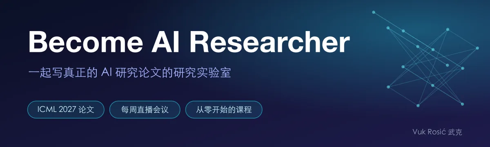
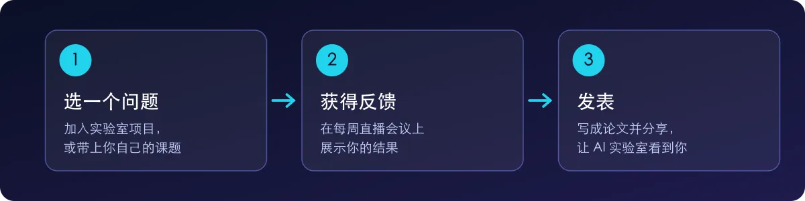
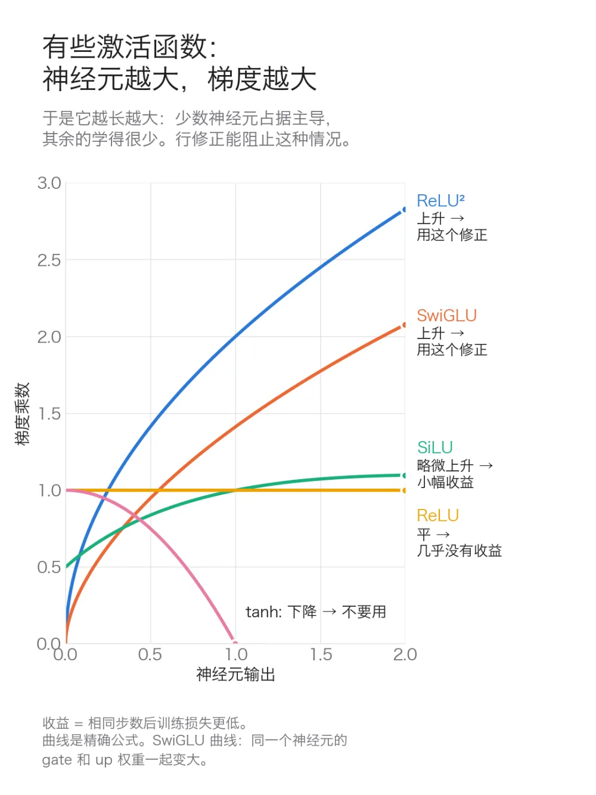

  

  
  &nbsp;
  

<b>6–12 个月内拿到 AI 研究岗位，或开始读博。</b>

我们正在为 **ICML 2027** 写论文。ICML 是顶级 AI 会议，2027 年 1 月截稿。你可以发表自己的论文，也可以作为合著者加入我或其他成员的论文。

由 **Vuk Rosić（武克）** 主持：前 Beam AI 研究员，Become AI Researcher 课程 11 万次观看，YouTube 2.47 万订阅。

## 实验室怎么运作

- **研究目标：** 从实验室项目中领取目标，或自己设定。
- **每周直播会议：** 每个人展示自己的研究，获得反馈。
- **实验室项目：** 都是真实的研究问题。加入一个，或带上你自己的课题。
- **让 AI 实验室看到你：** 在 X 上分享你的研究，建立你作为研究者的个人品牌。

## 社区里有什么

- 🧪 **真实的 AI 研究实验室**: 以论文为目标的项目
- 🎥 **7 小时以上的课程**: 从零开始的视频课程
- 🤖 **自动研究系统**: 自动运行实验的 AI 智能体
- 💬 **社区**: 提问、分享成果、获得反馈

## 研究方向

| 方向 | 示例问题 |
|---|---|
| Muon 优化器 | Muon 和注意力头如何相互作用？ |
| 注意力 | QK-norm 改变了注意力的哪些行为？ |
| 学习率调度 | warmdown 的长度如何影响最终损失？ |
| 分词器 | 词表大小如何影响小模型的学习？ |
| 模型层 | 不同层分别学到了什么？ |

我们 Muon 优化器研究中的一个结果：

## 加入

**[在 Skool 加入 Become AI Researcher →](https://www.skool.com/become-ai-researcher-2669)**

免费试用，随时取消。

**如果你在中国，无法在 Skool 付款，** 请加我微信：`vuk_ai`

**无法付款？** 请发邮件给我：[vukrosic1@gmail.com](mailto:vukrosic1@gmail.com)

## 关注

[YouTube](https://www.youtube.com/@vukrosic) · [X](https://x.com/VukRosic99) · Bilibili：vuk_ai
